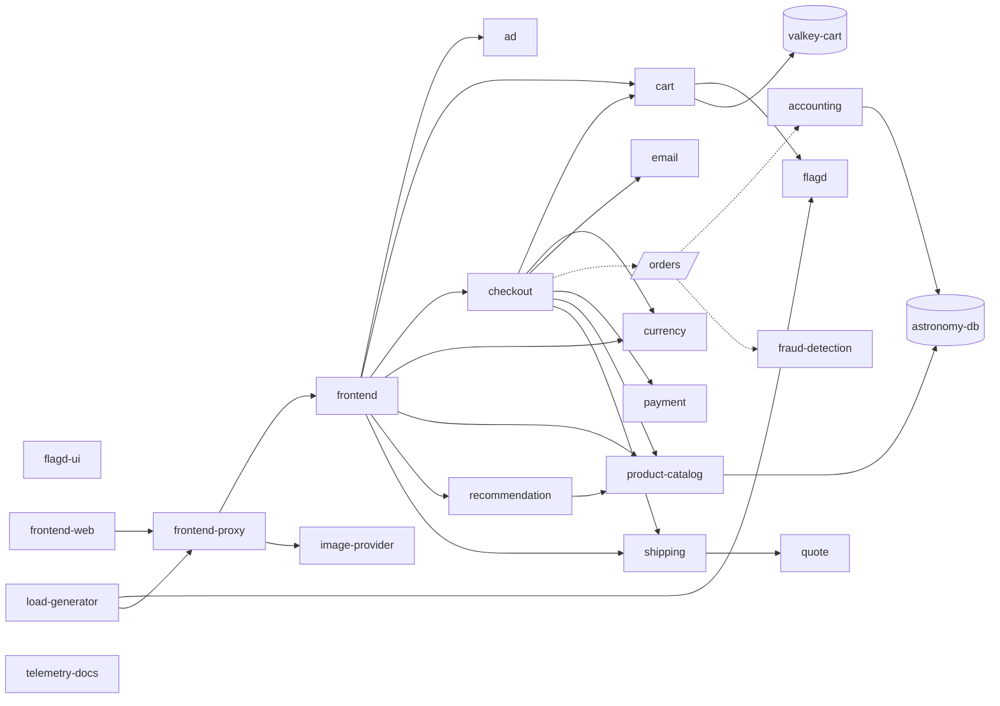

# Phase 3: service map

## What it is

```
traces backend ──► sample traces ──► extract edges ──► healthy map (Postgres snapshot, hourly)
                                                              │
incident window ──► sample the neighborhood's services ──► compare ──► get_service_map
                    (and the hour before)                     │         (and the Phase 4 starter pack)
                                                       neighborhood(service, hops)
```

- **Nodes:** traced services, untraced peers (databases, caches, hosts) and messaging topics.
- **Edges:**

  | Type | From | Measured on |
  |---|---|---|
  | `call` | a span whose child is in another service; or a client span to a named peer | the caller's span (duration, error on either side) |
  | `publish` | a producer span to its `messaging.destination.name` | the producer span |
  | `consume` | a topic to each consumer service | the consumer span; lag = consume start − linked publish end |

- **Per edge:** calls and errors in the sample, p50/p95, consumer lag p95, top operations, an example trace.

Everything comes from OpenTelemetry span kinds and semantic-convention attributes. No service, topic or metric names are configured.

## Live map of the demo

`python -m oncall.cli map --format mermaid`, built from traces of the last 24 hours minus incident periods. Boxes are services, cylinders untraced peers, the parallelogram a topic; dotted arrows are messaging.



## Decisions

| Decision | Why |
|---|---|
| Built from sampled traces through the `TraceBackend` adapter, not Jaeger's `/api/dependencies` | The dependencies API gives call counts only (no errors, latency or span links) and is Jaeger-only. One new adapter method, `services()`, is all a second backend needs. |
| Healthy sample: 8 slices spread over the window × 10 traces per service | Spreads the sample over the day instead of the last few minutes. About 160 small queries, run 4 at a time, once an hour. |
| Topics are nodes (`checkout → orders → fraud-detection`) | Consumers are linked to the producer with span links, not as children, so they are in a different trace. The topic name is on both sides, so the edge needs no cross-trace lookup. Producer traces are fetched (up to 20) only to measure lag. |
| A client span with no traced child still makes an edge, named from `peer.service` / `server.address` / `db.system` | Databases and caches show up. A service that is down produces no spans, but its callers' failing client spans still point at it. |
| IP addresses never name a node; such a client span is matched to the healthy map by `(caller, operation)` | Some SDKs set `server.address` to the IP, and container IPs change. The healthy map already knows which service `PaymentService/Charge` goes to. |
| Incident periods excluded from the healthy map: from 30 min before an incident opens to 10 min after its last alert resolves | Failures start before the alert fires and recovery takes a while. |
| An unresolved incident excludes at most 6 hours | A lost "resolved" notification would otherwise exclude everything after it. This happened in dev: two test incidents never got their resolve because the stack was stopped. |
| Snapshot = one row of JSON per build, last 48 kept | Read and written whole; history is there for debugging. |
| Rebuilt when an hour old (checked every 5 min), on demand if over 2 hours old at investigation time; if rebuilding fails, the old map is used and marked `stale` | A restarted worker doesn't rebuild a fresh map; an old map beats no map. A Postgres advisory lock makes concurrent requests wait for one build. |
| Map rebuilds run under their own leader lock and thread | A slow build never delays the 5-second flag poll. |
| Neighborhood = edges followed downstream and upstream for N hops (default 2) | Upstream shows who is affected, downstream shows candidate causes. Topics count as a hop. |

### What counts as a change

Each change is a significance test (chance below 1 in 1000), not a fixed threshold:

| Change | Test |
|---|---|
| `errors_up` | Binomial: this many errors in this many calls is very unlikely at the healthy error rate. The healthy rate uses add-half smoothing (0 errors in 50 calls is "below ~1/50", not exactly 0, so one error isn't infinitely surprising). At least 2 errors. |
| `slower`, `lag_up` | Binomial on the share of calls above the reference p95 (5% when nothing changed), **and** p95 at least 1.5× the reference. |
| `missing` | Poisson: the caller is active, and at its healthy share of calls we'd expect *e* calls; P(0) = e^−*e* < 0.001. |
| `new` | The same test the other way round: the healthy sample would almost surely have caught this edge. Rare edges the sample missed aren't flagged. |
| `not_seen` (service) | Queried, but no traces in the window. |

- **Latency and lag are judged against the hour before the window, not the healthy map.**
  - Live, every checkout call was 1.5–2.5× slower than the healthy map before the flag was flipped. The stack had just restarted, and the map came from a warm stack.
  - Against the day-long map, all of them were flagged "slower" during a payment-errors incident.
  - Latency drifts with load and warm-up, so it gets a recent reference, as `query_metrics` uses.
  - Errors, missing and new edges are rare events, so they keep the long healthy sample.
- **Error traces are fetched separately, only for example links.** They are a biased sample, so they never count toward error rates.
- **Call counts are sample counts, not rates.** Sampling is per query, so only shares (error ratio, latency) are comparable between healthy and now. The tool says so in its note. This changes the draft's "edges with call rate".

## Live verification

**`paymentFailure` → 50%** (incident `faac79dd`):
- `get_service_map --service checkout --hops 1`:
  - exactly two edges flagged: `checkout → payment` and `frontend → checkout`, both `errors_up` (9/32 vs 0/20 healthy);
  - checkout's other 6 dependencies unflagged.
- Two hops from payment: `frontend → checkout → payment`.
- Size: about 4.3 KB for one hop around checkout.

**`kafkaQueueProblems` → on** (window from the flip, two hops around checkout):

| Edge | Hour before | Window | Flagged |
|---|---|---|---|
| `orders → fraud-detection` | p95 2 ms, lag ≈0 | p95 1010 ms, lag p95 63.9 s | `slower`, `lag_up` |
| `orders → accounting` | lag ≈0 | lag p95 113 ms, 3× the messages | `lag_up` |
| `checkout → orders` (publish) | p95 36 ms | p95 82 ms | `slower` |
| 13 other edges, incl. the recovered `checkout → payment` | | | none |

The Kafka scenario is covered, so it doesn't need to be excluded from the eval. Phase 0 rated `kafkaQueueProblems` "partially visible"; consumer lag on the map makes it visible.

Size: about 9.5 KB (≈2.4k tokens) for two hops around checkout, the busiest service.

## Known limits

- At 5 users, the healthy map only has tens of calls per edge. More users or a longer window would tighten the tests.
- Long-lived streaming RPCs (e.g. flag provider streams) appear as calls lasting minutes. They are real spans; the model sees them as such.
- Topics count as a hop, so `checkout → orders → accounting` uses both of the default 2 hops.
